# MyHourly Backend Documentation

**Document type:** Reconstructed backend requirements and system design

**Purpose:** Explain what the backend does, how its modules work together, how its database is structured, and how its APIs support the business workflows.

**Document status:** reconstructed from the implementation. **Verified** statements are directly evidenced by source or Flyway DDL. **Inferred** statements are conservative interpretations of those artifacts. **Proposed** statements occur only in §9 and are not historical facts. This document intentionally omits credentials and deployment/test/CI/environment guidance.

## 1. Project overview

### 1.1 Purpose, problem, and objectives

**Inferred:** MyHourly is a single-organisation HRMS backend intended to replace disparate employee, time, leave, compensation, and HR-administration records with role-controlled APIs. It supports employee self-service, manager approval, HR administration, payroll preparation, announcements, reporting, performance review, and Indian Form 16/Form 16A tax-record maintenance.

**Verified scope:** `src/main/java/com/my_hourly` contains authentication, security, employee, master, attendance, leave, payroll, holiday, calendar, notification, performance, report, settings, lookup, Form 16 and Form 16A packages. There is no verified public candidate, project, timesheet, payment-gateway, or multi-tenant backend module.

### 1.2 Backend responsibilities

1. Authenticate users and enforce roles through Spring Security/JWT.
2. Persist and validate HR domain records using JPA/PostgreSQL.
3. Execute attendance, leave, payroll and approval rules transactionally.
4. Expose REST APIs, common success/error payloads, pagination, reports and PDF/file responses.
5. Send mail, store announcement attachments through an S3-compatible B2 service, and run scheduled HR reminders/maintenance.

### 1.3 Technology stack (verified)

Java 21; Spring Boot 4.0.7; Spring MVC, Security, Validation, Mail and Data JPA; PostgreSQL; Flyway; JJWT; Lombok; OpenAPI/Springdoc; Apache POI/XLSX; OpenPDF; AWS SDK S3-compatible B2 client. `pom.xml` also retains a MySQL runtime driver, but active profile properties use PostgreSQL.

## 2. Functional requirements

### 2.1 Roles

`RoleName`: `SUPER_ADMIN`, `HR_ADMIN`, `MANAGER`, `EMPLOYEE`, `PAYROLL_ADMIN`, `CLIENT`. The controller method annotations below are the authoritative endpoint permission source. `CLIENT` has no inspected module-specific endpoint guard; `PAYROLL_ADMIN` is used by payroll APIs.

### 2.2 Modules and requirements

| ID | Module / reconstructed requirement | Key implementation |
|---|---|---|
| FR-AUTH | Authenticate with credentials; refresh/logout; change/reset password; return current profile. | `AuthenticationController`, `AuthenticationServiceImpl`, refresh/revoked/reset-token entities. |
| FR-ADM | Privileged users register users, assign role, change account status, create/update employee profile and review attendance. | `AdminController`, `AdminServiceImpl`. |
| FR-ORG | Maintain department, designation and job-title hierarchy and employee/reporting-manager profile data. | master/employee/lookup packages. |
| FR-ATT | Employees record check-in, break start/end and checkout; system reports today/history/month/calendar/dashboard. | `AttendanceServiceImpl`, `AttendanceSettings`. |
| FR-REG | Authorised employee submits multi-day attendance correction; manager/HR/super action/revert its details. | `AttendanceRegularizationServiceImpl`. |
| FR-LEV | Maintain active leave types/balances; apply/cancel/approve leave, ledger transactions, annual allocation and approval history. | leave services/controllers. |
| FR-PAY | Maintain templates, salary structures/revisions, payment details, payroll versions/status/history and payslip PDF. | payroll services/controllers/PDF classes. |
| FR-HR | Maintain holidays, global calendar, company/attendance/leave settings, notifications, announcements, celebrations and reports. | holiday/calendar/settings/notification/report packages. |
| FR-PERF | Create/update/complete/search/delete performance reviews and review summaries. | `PerformanceServiceImpl`. |
| FR-TAX | Maintain Form 16, employer master, salary, exemptions, deductions, Chapter VIA, verification, quarter and challan records. | `form_16/**`, `Form_16A/**`. |

### 2.3 Verified business rules and constraints

- An employee belongs to one department, designation, job title and user account; reporting manager is an optional self-reference (`Employee`).
- Department/designation/job title codes, company code, holiday date, leave type name, payroll number, refresh token and reset-token hash have database uniqueness as defined by V1. Employee code is made unique by V3.
- Attendance status values are `PRESENT`, `LATE`, `HALF_DAY`, `ABSENT`, `LEAVE`, `HOLIDAY`, `WEEKEND`, `MISSED_CHECKOUT`; settings control office times, grace, minimum/half-day minutes, overtime and weekend/holiday attendance.
- Leave validation verifies active type, date ordering and overlapping pending/approved applications. Normal working-day calculation excludes weekends/holidays; configured Friday/Monday sandwich policies can force weekend dates into the leave calculation (`LeaveValidationServiceImpl`, V11).
- A manager approval is checked against the employee reporting hierarchy (`LeaveAuthorizationServiceImpl`). Approval produces a trail; approved paid days affect balance/transactions, while LOP does not deduct annual balance.
- V9/V10 formalise paid versus LOP days and per-calendar-month attribution. Historical requests lacking allocation rows use repository fallback documented by V10.
- Payroll rejects another active payroll for employee/month; gross, LOP, half-day amount, deductions and net payable are recalculated by `PayrollServiceImpl`. Payroll status values are `DRAFT`, `GENERATED`, `APPROVED`, `PAID`, `SUPERSEDED`, `CANCELLED`.

## 3. System architecture

### 3.1 Design and request processing

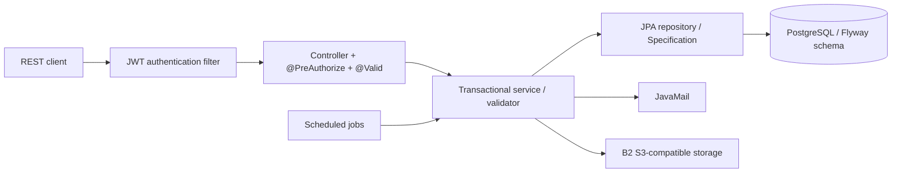

Controllers bind path/query/body/multipart input, use `@Valid` where declared, call service interfaces, and return either `ApiResponse<T>`/`PageResponse<T>` or direct DTO/binary responses. Services implement business transactions, mapping and authorisation. Repositories provide derived/JPQL/specification persistence. Entities map domain state. `GlobalExceptionHandler`, `ErrorResponseFactory`, `ApiError`, and custom bad-request/business/duplicate/forbidden/not-found/unauthorised exceptions centralise failure representation.

### 3.2 Major dependencies

Organisation data is prerequisite for employee; employee is prerequisite for attendance, leave, payroll, performance, notifications and Form 16. Holiday and settings influence attendance/leave. Approved leave and attendance feed payroll calculations. Notification/email is an effect of leave/attendance/announcement processes. Reports query attendance/leave without becoming an authoritative source.

## 4. Database design

This section describes the tables and constraints used to store backend data. The latest applicable migration is the authority for the database structure; the initial migration alone may not represent the current schema.

### 4.1 Schema authority and migration record

`V1__baseline_schema.sql` is the verified baseline; V2–V11 are authoritative subsequent changes. Runtime JPA uses schema validation, so migration DDL—not a guessed entity field—is used here. V2 payroll joining/template constraint; V3 unique employee code; V4 employee-type text; V5 Form 16 suite; V6 payroll half-day fields; V7 removes salary-template employee-type check/unique restriction; V8 adds query indexes; V9 paid/LOP/approver; V10 monthly leave allocations; V11 sandwich fields/forced-date JSON.

### 4.2 Tables and exact field design

All baseline IDs are `bigint generated by default as identity`; timestamp audit fields are `created_at timestamp(6) not null`, `updated_at timestamp(6)` unless noted. `PK` denotes primary key; `FK` references listed relationships. Fields marked `!` are NOT NULL. Exact V1 DDL is `src/main/resources/db/migration/V1__baseline_schema.sql`.

| Table | Columns (type; `!` non-null) |
|---|---|
| `users` | `id PK`, `created_at!`, `updated_at`, `last_login`, `password_changed_at` timestamps; `username varchar(50)!`, `email varchar(100)!`, `password varchar(255)!`; `role varchar(30)!` check RoleName; `user_status varchar(30)!` check ACTIVE/INACTIVE/LOCKED/DISABLED/PASSWORD_EXPIRED. |
| `employees` | `id PK`; `user_id bigint! unique FK users`; `department_id`, `designation_id`, `job_title_id bigint!` FKs; `reporting_manager_id bigint` self FK; names `varchar(50)`; `email varchar(255)! unique`, phone 15; employee code unique after V3; dates; profile photo OID/name/type; active boolean!; enums employment type, gender, role. |
| `departments` | id/audit, `department_code varchar(20)! unique`, `department_name varchar(100)!`, `description varchar(255)`, `active boolean!`. |
| `designations` | id/audit, `department_id bigint! FK`, code/name `varchar(255)! unique`, description, active. |
| `job_titles` | id/audit, `designation_id bigint! FK`, `job_title varchar(100)!`, code varchar(255)! unique, active. |
| `attendance` | id/audit; `employee_id bigint! FK`; `attendance_date date!`; check-in/out timestamps and numeric(10,7) locations; working/break/late/early/overtime minutes; status and employee-state enum checks. |
| `attendance_breaks` | id, `attendance_id bigint! FK`, start/end timestamps, `break_minutes integer`, `break_type varchar(255)!` check. |
| `attendance_regularization` | id/audit, employee FK, from/to dates!, request/approval/rejection dates, approver/rejector IDs, status varchar(30)! check, reason/rejection reason varchar(500). |
| `attendance_regularization_detail` | id/audit, regularization/attendance FKs, original/requested/approved in/out timestamps/statuses; status check PENDING/APPROVED/REJECTED/REVERTED; remarks varchar(500). |
| `attendance_settings` | id/audit; active, cutoff/grace/minimum/half-day integer!, office times!, overtime/weekend/holiday flags!. |
| `holidays` | id/audit; `holiday_date date! unique`, name varchar(100)!, description varchar(300), active/recurring/attendance_allowed booleans!, type enum check. |
| `leave_types` | id/audit; `name varchar(50)! unique`, description, allocated days/monthly guideline integers!, paid/carry-forward/active booleans!. |
| `leave_settings` | id/audit; annual paid leave/monthly guideline integers!, active/carry-forward booleans!; V11 sandwich Monday/Friday/Friday-Monday booleans! default false. |
| `leave_balances` | id/audit; employee/type FKs!, year/allocated/used/expired/remaining integers!; unique(employee,type,year). |
| `leave_requests` | id/audit; employee/type FKs!, dates!, total days!, status check, reason varchar(500)!; V9 `paid_days`, `lop_days`, `approved_by FK employees`; V11 `forced_working_days_json text`. |
| `leave_approvals` | id/audit; request and approver FKs!, action APPROVE/REJECT and level MANAGER/HR checks!, remarks varchar(500). |
| `leave_transactions` | id/audit; employee/type FKs!, optional request FK, before/after/days ints!, transaction-type check, remarks. |
| `leave_request_month_allocations` | V10: id/audit, request FK!, allocation month date!, paid/working days ints!, unique(request, month), cascade delete request. |
| `salary_templates` | id/audit; active; salary components numeric(12,2)!; `employee_type varchar(30)!`. V7 removes its original check and unique constraint. |
| `salary_structures` | id/audit; employee FK!, optional template FK, effective dates, status check ACTIVE/INACTIVE, components numeric(12,2)!, remarks. |
| `employee_payment_details` | id/audit, employee FK! unique; bank/account/IFSC required; optional PAN/ESI/PF/UAN; payment mode check. |
| `payrolls` | id/audit; employee/structure FKs!, approver FK; payroll/employee display fields, month/date/status/version, days, all component/deduction amounts numeric(12,2)!, payroll number varchar(30)! unique; V6 `half_days int! default 0`, `half_days_amount decimal(12,2)! default 0.00`. |
| `payroll_history` | id/audit, payroll FK!, optional performer FK, action check, remarks varchar(500). |
| `performance_reviews` | id/audit, employee/reviewer FKs, review period/type/status/rating/score, feedback text; unique employee/type/month/year. |
| `notifications` | id/audit, employee FK!, reference ID, read flag!, priority/type/reference-type checks, title varchar(150)!, message varchar(1000)!. |
| `announcements` / `announcement_attachment_urls` | announcement audit/id/title 150!/message 1000!/upload-type check; attachment join `announcement_id FK`, `attachment_url varchar(1000)`. |
| `company_settings` | id/audit, active/working days, company code varchar(30)! unique, identity/contact/address fields and timezone/currency. |
| security token tables | `refresh_tokens` (user FK, unique token, expiry/revocation); `revoked_tokens` (unique token, expiry); `password_reset_tokens` (user FK, unique hash, expiry/used timestamp). |
| Form 16 suite | Created/altered by V5; their exact table/column DDL and FKs are in V5 because V1 intentionally does not define all Form 16 tables. Entity classes under `form_16/entity` and `Form_16A/entity` are the inspected mapping source. |

### 4.3 Constraints, indexes, and differences

V8 indexes attendance(employee,date)/(date), break attendance, regularization employee/detail FKs, reporting manager, designation/job-title lookup FKs, leave request employee/status/update, leave transaction/request, approvals, notifications employee/read/created, performance reviewer, payroll employee/month/history, salary structure employee/status, users username/email, and refresh token user/revoked. V8 deliberately does **not** make username/email unique. Entity/schema discrepancies are not silently inferred: V7 explicitly relaxes template employee type; V9–V11 augment baseline leave tables; V5 is required for the Form 16 physical schema.

## 5. Entity relationship diagram (ERD)

The diagram below shows the core relationships that are supported by the supplied schema summary. Form 16/Form 16A relationships need a further source-level check before the diagram can be called exhaustive.

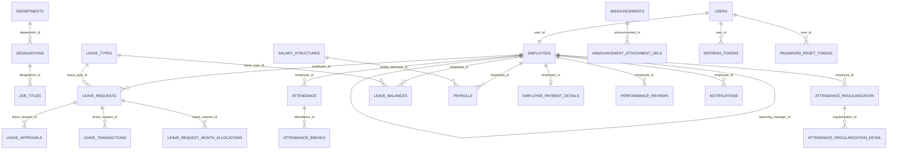

The ERD intentionally excludes relationships not confirmed in V1/V5/entity mappings. `announcement_attachment_urls` is a value-collection join table. `employees.reporting_manager_id` is the self-referencing management hierarchy. Form 16 relationships are documented in V5, whose exhaustive table suite must be consulted for that additional subgraph.

## 6. API specifications

The endpoint list below is a module-level register. For a definitive API contract, exact mappings and DTO fields must be checked against each controller and request/response class.

### 6.1 Common contract

Protected calls use `Authorization: Bearer <JWT>`. Controller request DTOs are under each module’s `api/request` or `dto/request`; response DTOs are adjacent. `@Valid` triggers Bean Validation where the method declares it. `ApiResponse<T>` is common but Form 16/payroll endpoints often return direct DTOs, report endpoints return JSON or export bytes, and profile/payslip endpoints return bytes. Status is controller-defined (create typically 201, normal read/update 200); errors are mapped by `GlobalExceptionHandler`.

### 6.2 Complete active endpoint register

| Module/controller | Method and complete URL | Purpose / input / service |
|---|---|---|
| Auth | POST `/api/v1/auth/login`, `/token/refresh`, `/logout`, `/change-password`, `/forgot-password`, `/reset-password`; GET `/me` | respective request DTOs; AuthenticationService; auth prefix is public at filter level, `/me` has `isAuthenticated`. |
| Admin | POST `/api/v1/admin/users/register`, `/employee-profile/{userId}` multipart, `/users/{userId}/roles`; PUT `/employee-profile/{userId}`; GET `/users`, `/users/{userId}`, `/attendance`, `/attendance/employee/{employeeId}`; PATCH `/users/{userId}/status` | class guard super/manager/HR; `AdminService`. |
| Employee | PUT `/api/v1/employees/profile-photo` multipart, `/api/v1/employees`; GET `/api/v1/employees/{id}`, `/`, `/dropdown`, `/me`, `/{id}/profile-photo`; PATCH `/{id}/status` | Employee service; broad self update, admin/manager listing. |
| Master | Departments/designations/job-titles each: POST `/api/v1/{resource}`, GET `/{id}` and `/`, PUT `/{id}`, PATCH `/{id}/status`, DELETE `/{id}` | create/update DTO per resource; HR/manager guards. |
| Lookup/calendar/holiday | GET `/api/v1/lookups/departments`, `/departments/{id}/designations`, `/designations/{id}/job-titles`, `/reporting-managers`, `/employee-id-name`; GET `/api/v1/calendar`; holiday POST/GET/PUT/DELETE `/api/v1/holidays`, GET `/calendar`, `/upcoming` | lookup/calendar/holiday services; holiday mutation HR/manager. |
| Attendance | POST `/api/v1/attendance/check-in`, `/break-start`, `/break-end`, `/check-out`; GET `/today`, `/history`, `/monthly-summary`, `/calendar`, `/dashboard` | check-in/out/break DTOs; employee/manager/HR/super guard; AttendanceService. |
| Regularisation | POST `/api/v1/attendance-regularizations`; GET `/my`, `/pending`, `/all`, `/{id}`; PATCH `/{regularizationId}/details/{detailId}`; POST `/{regularizationId}/details/{detailId}/revert` | create/action detail DTOs; manager/HR/super action. |
| Leave | POST `/api/v1/leave-requests`; PUT `/{id}/cancel`; GET `/{id}`, `/my`, `/team`, `/`; leave type CRUD `/api/v1/leave-types`; balance GET `/api/v1/leave-balances/my`, `/employee/{id}`, `/{id}`, `/`; transactions GET `/api/v1/leave-transactions/my`, `/employee/{id}`, `/leave-request/{id}` | LeaveRequestRequest/LeaveActionRequest; services listed in §7. |
| Leave action/allocation | PUT `/api/v1/leave-approvals/{id}/leave-approval-by-manager`; GET `/leave-request/{id}`; POST `/api/v1/leave-allocation/all-employee`, `/leave-type/{id}` | manager-action DTO / allocation service. |
| Settings/notifications | GET/PUT `/api/v1/settings/attendance`, `/leave`, `/company`; notifications GET `/api/v1/notifications`, `/unread-count`, `/announcement/today`, `/upcoming-birthdays`, `/celebration-wall/today`; PATCH `/{id}/read`, `/read-all`; POST `/announcement` multipart | settings DTOs; notification paging/announcement request. |
| Payroll | Templates `/api/v1/payroll/salary-templates`; structures `/salary-structures`, `/revision`, `/{id}`, `/employee/{id}`; payment details `/payment-details`; payroll POST `/api/v1/payroll/generate`, GET `/{id}`, `/number/{n}`, `/employee/{id}`, `/month`, `/status`, PUT/PATCH `/{id}`, POST `/{id}/regenerate`, GET `/{id}/payslip` | payroll DTOs; payroll roles as controller annotations. |
| Reports/performance | GET `/api/v1/reports/attendance`, `/leave`; performance POST `/api/v1/performance`, `/search`, `/get-summary`, PUT `/{id}`, `/{id}/complete`, GET/DELETE `/{id}` | report filters/query; performance DTOs. |
| Form 16 | `/api/v1/form16/{employeeId}`, `/{id}`, `/employee/{id}`, activation/delete routes; `/api/form16/{form16Id}/{salary|exemption|chapter-via|section16-deduction|last-fields}` CRUD/auto-save variants; `/api/form16/employer-master` CRUD; `/api/v1/form16/{form16Id}/{challan|quarter|verification}` CRUD variants | Form DTOs/entities; manager/HR writers, employee/manager/HR selected reads. |

All controller method names and annotations are in their corresponding `*Controller.java`; those sources define exact optional query parameters, Bean Validation annotations and response generic types. No inactive commented mappings are included.

## 7. Business workflows

These workflows explain the main business paths from request to database changes. Where exact calculation formulas or edge-case rules are not present in the supplied source summary, they are identified as needing verification.

### 7.1 Authentication

Login validates credentials through the authentication manager, loads custom user details, produces access/refresh tokens and records access state. Refresh validates non-revoked refresh token; logout revokes it. Password reset creates/validates expiring hashed reset tokens and sends mail. Failures are authentication, validation, expired/revoked-token or account-status exceptions.

### 7.2 Attendance and regularisation

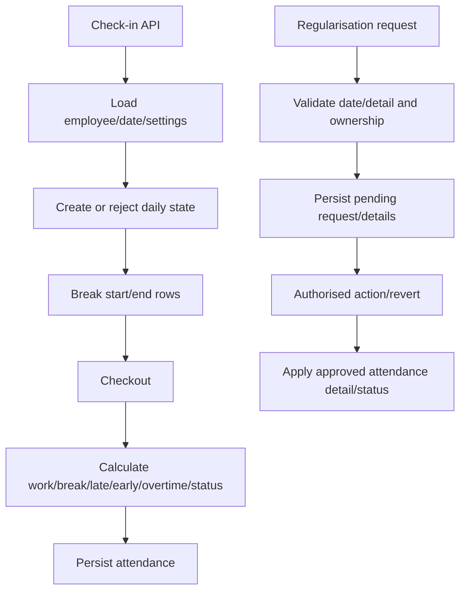

### 7.3 Leave

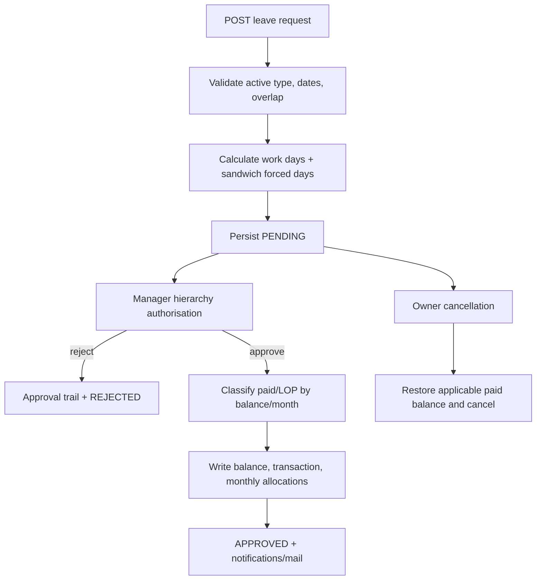

The participating services are `LeaveValidationService`, `LeaveAuthorizationService`, `LeavePaidLopService`, `LeaveBalanceService`, `LeaveTransactionService`, `LeaveApprovalService`, `LeaveAllocationService` and `LeaveRequestService`. Database writes are the tables specified in §4. Approval failure leaves no approved balance mutation because these operations are transactional.

### 7.4 Payroll

Generation validates employee/month and absence of active duplicate, reads active salary structure and attendance summary, calculates gross/LOP/half-day/deductions/net payable, writes payroll and history. Update and regeneration recompute derived totals; status/paid events add history. PDF generation validates payroll before emitting binary content. Failure cases include missing employee/structure, duplicate active payroll and invalid calculated salary constraints.

### 7.5 Other workflows

Masters/holidays/settings follow validated CRUD, with master hierarchy validation. Notifications are created/read/paged; announcements validate multipart data then upload B2 attachments and persist announcement/URLs. Reports filter attendance/leave and select JSON/Excel/PDF export. Performance creates a period-specific review, updates/completes it and derives summaries. Form 16 workflows create a form for an employee then maintain each associated tax subsection with separately guarded CRUD.

### 7.6 Module-by-module workflow catalogue

This section describes the workflow for each backend module identified in the supplied documentation. It explains the normal processing path, the important checks, and the expected data changes. Exact implementation details must still be confirmed in the corresponding controller, service, repository, entity, and migration files. A route or class existing in the repository does not, by itself, prove that every path works end to end.

#### 7.6.1 Authentication and account lifecycle

**Main path: sign in**

1. The client submits login credentials to the authentication API.
2. The authentication service delegates credential verification to Spring Security.
3. The service checks the account/user state as implemented.
4. On success, access and refresh tokens are created and token state is persisted where required.
5. The API returns the authentication response.
6. Protected requests later pass through the JWT filter before reaching controllers.

**Refresh and logout**
- Refresh: receive refresh token → validate token, expiry, and revocation state → resolve user → issue the applicable token response.
- Logout: receive token/session context → revoke the refresh token or applicable token state → return the logout result.
- Password reset: accept reset request → create a hashed, expiring reset token → send reset message → validate token on submission → update password and mark token used.
- Current profile: authenticate caller → resolve current user → return profile data.

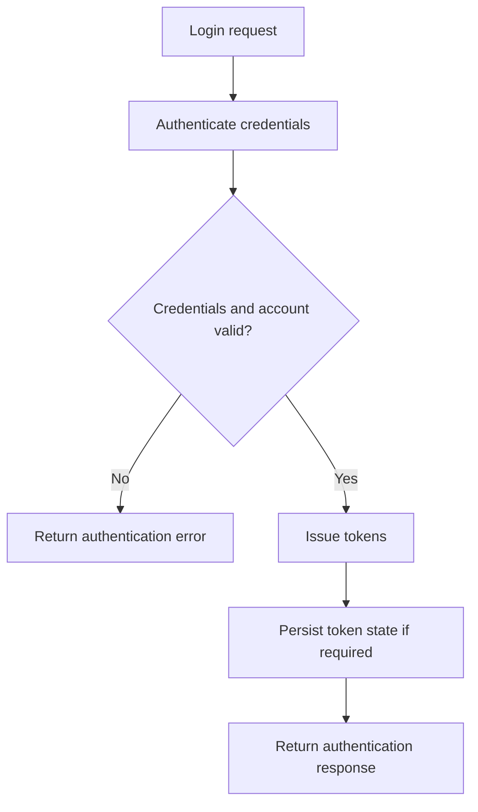

**Data involved:** `users`, `refresh_tokens`, `revoked_tokens`, `password_reset_tokens`.

#### 7.6.2 Administration and user management

**Main path: create a user**

1. An authorised administrator submits user registration data.
2. The API validates the request DTO.
3. The service checks required uniqueness and role/account rules.
4. The service creates the user account and associates any required employee profile.
5. Related records are saved within the implemented transaction boundary.
6. The response returns the created record or a standard success wrapper.

**Other paths**
- Role update: authorise caller → validate target user and requested role → update role → return result.
- Account status change: authorise caller → validate target and new status → persist status → return result.
- User/attendance lookup: authorise caller → apply supported filters → load requested records → map to response DTOs.
- Employee profile multipart creation/update: validate text fields and photo metadata → process the file according to current storage logic → persist profile/file reference → return result.

**Key checks:** Only permitted roles should register users, assign privileged roles, or change another user's status. The exact policy is controlled by controller guards and service validation.

#### 7.6.3 Employee management

**Main path: create or update an employee profile**

1. Receive employee details.
2. Validate required fields and referenced user account.
3. Resolve department, designation, and job title.
4. Validate relationships between the selected master records where implemented.
5. Resolve optional reporting manager.
6. Save or update the employee.
7. Return the mapped employee response.

**Profile-photo path:** receive multipart image → validate accepted type/size according to implementation → store the photo or its database reference → set/update photo metadata → return the response. Retrieval resolves the employee and returns the stored image/binary content.

**Important relationships:** `employees.user_id` is unique; department, designation, and job-title references are required in the documented schema; `reporting_manager_id` is an optional self-reference.

#### 7.6.4 Organisation master data: departments, designations, and job titles

**Create/update workflow**

1. An authorised user submits a master-data request.
2. Validate required names, codes, and fields.
3. For a designation, resolve its department.
4. For a job title, resolve its designation.
5. Check uniqueness constraints and parent-child consistency.
6. Save the record and return the mapped response.

**Status/deletion workflow:** resolve record → check authorisation and any dependency rules → update active status or attempt deletion → return success or a domain/database error.

The schema summary establishes the hierarchy but does not establish whether deletion is blocked, soft-deleted, or permitted when employees already reference a record. Document the actual behavior from the service and migration constraints.

#### 7.6.5 Lookup APIs

**Workflow**

1. Client requests a dropdown or lookup list.
2. The controller receives any parent ID, such as department or designation.
3. The service queries the relevant master records.
4. The API returns IDs and display names for frontend selection.

Examples documented include departments, designations for a department, job titles for a designation, reporting managers, and employee ID/name pairs. Lookup APIs should return only the fields needed by the caller and must follow the implemented access rules.

#### 7.6.6 Attendance

**Main path: daily attendance**

1. Employee calls check-in.
2. Service resolves the employee, current date, attendance record, and active attendance settings.
3. It checks whether attendance is permitted for that day and whether a check-in already exists.
4. If valid, it records the check-in timestamp and applicable location data.
5. Break-start and break-end calls validate the current attendance state and record break intervals.
6. Checkout validates the current state and records checkout time.
7. Service calculates working time, break duration, late minutes, early departure, overtime, and attendance status according to the active settings.
8. The attendance record is saved and the API returns the result.
9. Read APIs provide today, history, monthly summary, calendar, and dashboard views from stored records and supported calculations.

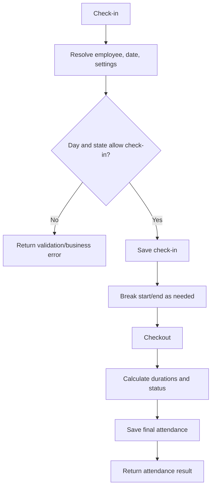

**Policy inputs:** The project has previously specified 9:30 AM office start, 6:30 PM office end, 45-minute grace period, 8 hours for Present, 4 hours for Half Day, lunch from 1:00 PM to 2:00 PM, and a missed-checkout allowance of up to 3 hours after the checkout time. Treat these as intended policy values and verify the active `attendance_settings` row, configuration defaults, and calculation code before treating them as the current runtime behavior.

**Important edge cases:** duplicate check-in, checkout without check-in, repeated checkout, an open break at checkout, missed checkout, holiday/weekend attendance restrictions, timezone/date boundaries, and concurrent requests.

#### 7.6.7 Attendance regularisation

**Main path**

1. Employee submits a regularisation request with a date range and correction details.
2. Service validates the range, ownership, required details, and existing attendance records.
3. The request and detail rows are saved in a pending state.
4. An authorised reviewer loads the request and chooses an allowed action for a detail.
5. The service records the reviewer, decision, timestamps, and remarks.
6. For an approved correction, the relevant attendance fields are updated according to the implementation.
7. A revert operation restores or reverts an approved detail according to the implemented rules.
8. The API returns the updated request/detail state.

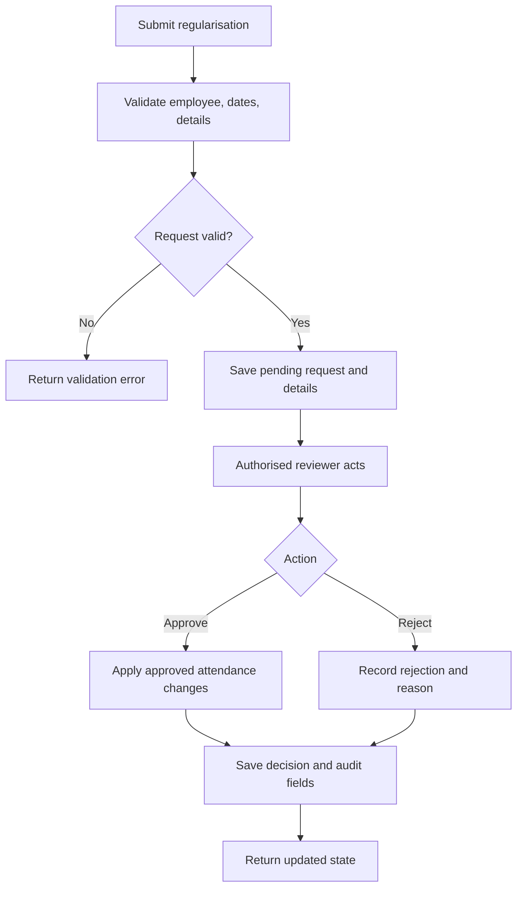

#### 7.6.8 Leave types and leave settings

**Leave-type maintenance:** authorised caller submits a create/update/status request → validate name and policy fields → enforce uniqueness and constraints → persist the leave type → return the updated record.

**Leave-settings maintenance:** authorised caller reads or updates organisation leave settings → validate numeric limits and policy flags → persist annual/monthly guidance, carry-forward, and sandwich policy options → return settings.

These settings influence request validation and allocation. Updating a setting does not necessarily retroactively recalculate existing approved requests; that behavior must be confirmed in the service code.

#### 7.6.9 Leave request application and validation

**Main path: submit leave**

1. Employee submits leave type, start/end dates, and reason.
2. Service resolves employee and active leave type.
3. It validates date ordering and required fields.
4. It checks overlap with pending or approved leave requests.
5. It calculates working days using the applicable weekend and holiday rules.
6. It applies configured sandwich rules and records any forced dates if supported.
7. It allocates working days by calendar month when required.
8. It creates the leave request in pending status.
9. It returns the request details.

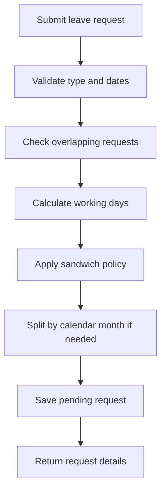

**Sandwich-policy examples previously specified for this project:** a Friday-only leave may count Friday plus Saturday and Sunday (3 chargeable days); a Monday-only leave may count Saturday, Sunday, and Monday (3 days); Friday plus Monday leave may count Friday through Monday (4 days). These examples describe the intended policy and must be checked against `LeaveValidationServiceImpl` and the current `leave_settings` values.

#### 7.6.10 Leave approval and rejection

**Approval path**

1. Manager/authorised approver requests pending leave items.
2. Service verifies the caller's role and relationship to the employee, where required.
3. Approver selects approve or reject and may provide remarks.
4. Service verifies that the request is still in a valid pending state.
5. On rejection, it records the decision and approval history without deducting paid leave balance.
6. On approval, it calculates paid days versus LOP for the applicable month(s).
7. It updates the request, records approver information, writes balance transactions and monthly allocations, and triggers configured notifications.
8. It returns the final decision state.

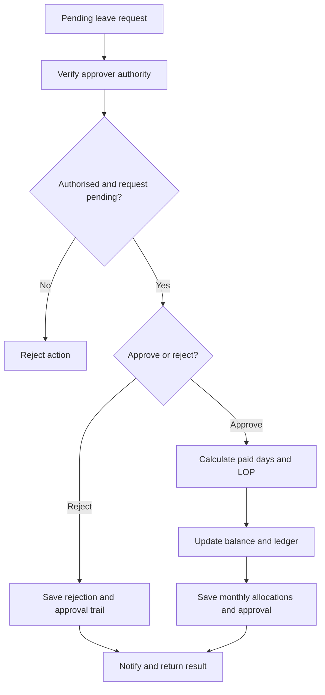

**Paid/LOP rule:** The supplied project documentation says paid days affect leave balance while LOP days do not deduct annual leave balance. The project policy previously specified up to two paid leaves per month, with additional approved leave treated as LOP. Verify that the current implementation applies the limit by calendar month and handles requests crossing month boundaries as intended.

**Cancellation rule:** The project requirement previously specified that approved leave should not be cancellable. Therefore, the cancel endpoint should be documented as allowing cancellation only for statuses permitted by the actual implementation; do not describe approved-leave cancellation or balance restoration as supported unless the source code proves it.

#### 7.6.11 Leave balances, transactions, and allocation

**Balance lookup:** authenticate/authorise caller → resolve employee and year/type filters → read balance rows → return allocated, used, expired, and remaining values.

**Transaction history:** resolve caller and requested employee/request → check access → query leave transactions → return ledger entries.

**Allocation workflow:** authorised HR/admin invokes an allocation operation → service resolves eligible employees and leave type → validates allocation parameters and existing balances → creates or updates balance records and transaction history according to implementation → returns the allocation result.

**Data consistency requirement:** Whenever approval changes a balance, the balance change and corresponding transaction/allocation records should remain consistent. The actual transaction boundary and duplicate-allocation protection must be confirmed in the service and database constraints.

#### 7.6.12 Holidays and calendar

**Holiday creation/update:** authorised user submits holiday details → validate date, name, type, recurring/active flags, and attendance permission → enforce unique holiday date → save → return the holiday.

**Calendar/read workflow:** request calendar or upcoming holidays → service queries relevant dates and active records → combines data as implemented → returns calendar entries.

Holiday records can affect attendance eligibility and leave working-day calculations. Confirm whether recurring holidays are expanded at query time or materialised as dated records; the supplied summary does not establish that detail.

#### 7.6.13 Attendance, leave, and company settings

**Settings update workflow**

1. Authorised caller requests the current settings or submits an update.
2. Controller validates the request DTO.
3. Service validates time ranges, numeric limits, working days, company code, and policy flags as applicable.
4. Service saves the settings record.
5. Subsequent attendance, leave, or calendar operations read the applicable active settings.
6. API returns the saved configuration.

The three settings areas have different effects:
- Attendance settings affect daily attendance and time calculations.
- Leave settings affect allocation, carry-forward, and sandwich rules.
- Company settings affect company identity and other configured organisation values.

#### 7.6.14 Payroll setup: salary templates and salary structures

**Salary template workflow:** authorised payroll user creates or updates a template → validate salary component values and employee-type input according to current schema rules → persist template → return template.

**Salary structure workflow:** select employee and optional template → validate employee/template and effective dates → calculate or map component values → create or revise the employee's structure → manage active/inactive state → return the structure.

**Payment details workflow:** authorised caller submits employee payment and statutory details → validate required bank/account/IFSC and applicable payment mode → persist the employee's payment-details row → return a safe response. Sensitive account values should not be unnecessarily exposed in responses or logs.

#### 7.6.15 Payroll generation, approval, payment, and payslip

**Generation path**

1. Payroll user selects employee/month or invokes the applicable generation operation.
2. Service validates employee and month.
3. It prevents a duplicate active payroll for the same employee/month.
4. It resolves the applicable salary structure.
5. It reads attendance and leave/LOP data for the period.
6. It calculates gross pay, LOP adjustment, half-day amount, deductions, and net payable.
7. It persists the payroll record and history.
8. It returns the generated payroll.

**Lifecycle path:** a permitted status action is submitted → validate the current and requested statuses → validate role and transition rules → update status and relevant metadata → append `payroll_history` → return the updated payroll.

**Regeneration path:** load payroll → verify regeneration is permitted → reload applicable salary and attendance/leave inputs → recalculate derived values → save revised version/history according to implementation.

**Payslip path:** resolve payroll by ID → verify access and eligibility → generate PDF from the persisted payroll values → return PDF bytes.

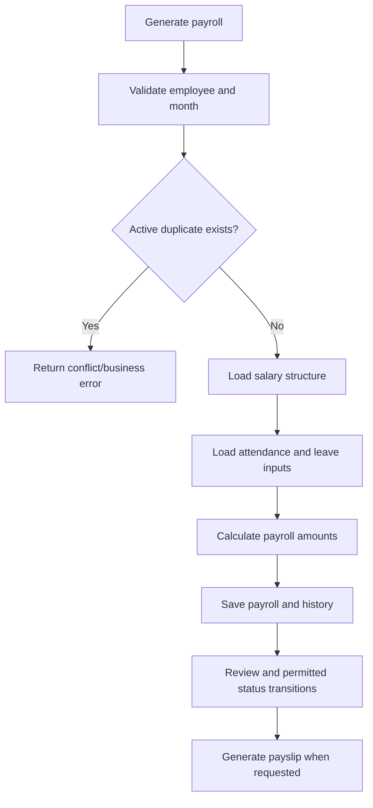

The exact payroll formulas and legal/statutory deductions must be read from the calculation code and must not be inferred from field names alone.

#### 7.6.16 Notifications

**Notification read workflow:** authenticated user requests notifications → service scopes results to the permitted employee/user → applies paging/filtering → returns notifications and unread count.

**Mark read workflow:** user selects one notification or all notifications → service verifies ownership/scope → updates read state → returns the updated result.

Notifications may be created by other workflows, such as leave actions or announcements. The precise trigger list should be derived from calls to the notification service rather than assumed.

#### 7.6.17 Announcements and attachment storage

**Creation workflow**

1. Authorised user submits announcement fields and multipart attachments.
2. Service validates announcement data and supported upload rules.
3. Attachments are uploaded to the configured S3-compatible storage.
4. The announcement record is saved.
5. Attachment URL rows are associated with the announcement.
6. The API returns the created announcement.

**Read workflow:** request announcement data → service retrieves announcement and attachment URL records → return the permitted response.

The exact ordering and cleanup strategy for failures between object upload and database commit must be confirmed in the implementation. Avoid claiming atomicity across database and object storage unless compensating logic exists.

#### 7.6.18 Celebration wall and birthday information

**Workflow:** request today's celebration or upcoming birthdays → service determines the applicable date range/timezone → queries eligible employee data and relevant announcements → applies visibility rules → returns celebration/birthday entries.

The supplied endpoint register confirms these read operations but does not fully specify birthday date handling, privacy rules, or timezone behavior. Those details require source verification.

#### 7.6.19 Reports and exports

**Workflow**

1. Caller requests an attendance or leave report with supported filters.
2. Controller validates filter inputs and access.
3. Service constructs the appropriate query.
4. Repository retrieves matching records and aggregate values.
5. Service maps results into report DTOs.
6. For an export request, the relevant exporter generates the supported output format.
7. The API returns JSON or file/binary content as implemented.

Verify the exact supported formats, filters, aggregation formulas, and role restrictions from each report controller and service. Do not assume every report supports every export format.

#### 7.6.20 Performance reviews

**Create workflow:** authorised reviewer submits review data → service validates employee/reviewer, period, type, rating/score and required fields → checks for a duplicate employee/type/month/year record → persists review → returns result.

**Update workflow:** load review → verify access and editable status → validate new values → save and return.

**Complete workflow:** load review → verify permitted transition and required fields → change review status to completed → save and return.

**Search/summary workflow:** validate filters → query review records → aggregate or map results → return list or summary.

**Delete workflow:** resolve review → authorise caller → check deletion rules → delete or deactivate as implemented → return result.

The unique constraint is an important final guard against duplicate period reviews, but the exact rating scale and completion prerequisites must be confirmed from the implementation.

#### 7.6.21 Form 16

**General workflow based on the documented module structure**

1. Resolve the employee and create or retrieve the applicable Form 16 record.
2. Verify that the caller has permission to create or read the record.
3. Maintain related salary, exemption, Chapter VI-A, section 16 deduction, and final-field data through the applicable endpoints.
4. Maintain employer master information where required.
5. Maintain quarter, challan, and verification information through the associated APIs.
6. Return the relevant Form 16 record or subsection response.

The exact parent-child relationships, required subsection order, calculation behavior, and finalisation rules cannot be confirmed from the supplied summary alone. They must be derived from the Form 16 entities, DTOs, services, controllers, and Flyway migration V5.

#### 7.6.22 Form 16A

The supplied documentation names a `Form_16A` package but does not provide a complete route register or enough schema details to state its entire workflow confidently.

To complete this workflow, trace the Form 16A controller entry point → request DTO validation → service method → entity/repository operations → response mapping. Add its specific steps only after inspecting those files. Do not assume that Form 16A has the same lifecycle or relationships as Form 16.

#### 7.6.23 Cross-module workflow: employee setup to HR operations

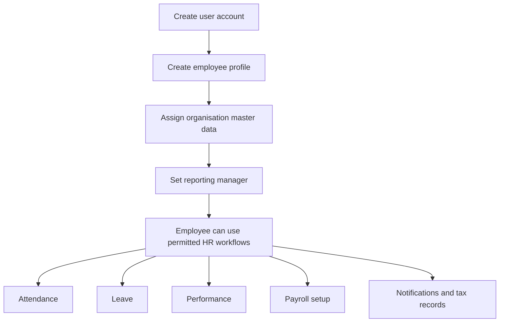

This is a logical dependency flow, not necessarily a single transaction. Each operation has its own API, validation, and persistence behavior.

#### 7.6.24 Cross-module workflow: attendance and leave to payroll

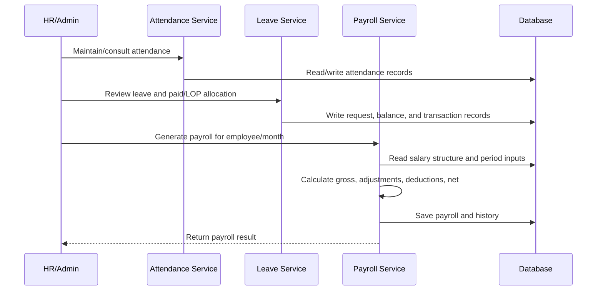

The exact period cutoffs and calculation inputs must be confirmed in `PayrollServiceImpl`.

## 8. Security requirements

`SecurityConfig` uses stateless Spring Security, disables CSRF, enables CORS, authenticates through DAO user details/password encoder, adds JWT filter before username/password filter, and sends unauthenticated/forbidden exceptions to dedicated handlers. Public patterns are auth, Swagger/OpenAPI and health; all other requests require authentication. Method-level `@PreAuthorize` is enforced because `@EnableMethodSecurity` is enabled. Input validation is DTO Bean Validation plus service business validation. Do not rely on a client role/menu for authorisation.

## 9. Reconstructed development plan (proposed)

This is a recommended dependency order inferred from the system, not original history.

| Phase | Deliverables | Acceptance criterion |
|---|---|---|
| 1 Foundation | PostgreSQL/Flyway, base audit/error/response, security | clean schema, authenticated protected request, standard failure response. |
| 2 Organisation | roles/users, masters, employees/lookups | hierarchy and reporting manager persist with constraints. |
| 3 Time and leave | settings/holidays, attendance, regularisation, leave/balance/approvals | end-to-end check-in and paid/LOP/sandwich approval correctness. |
| 4 Compensation | payment, templates, structures, payroll/history/payslip | reproducible calculations and duplicate-month prevention. |
| 5 HR operations | notifications, reports, performance, Form 16 | guarded CRUD/export records and scheduled side effects. |
| 6 Hardening | API contract review, security and data-integrity verification | every active controller route has accepted/denied/invalid-input evidence. |
---

---

> **Evidence boundary:** This expansion is based on the supplied `BACKEND_DOCUMENTATION.md`, not on direct access to the backend repository. It expands the documented design and makes incomplete areas explicit. Exact DTO fields, every controller parameter, and the full Form 16/Form 16A physical schema cannot be safely reconstructed from the supplied summary alone; those items must be verified against the referenced Java files and Flyway migrations before being treated as exhaustive.

## 10. Detailed module guide

Use this section when you want to understand a specific part of the backend. Each module description explains its purpose, main data, important rules, and what still needs to be verified.

### 10.1 Authentication and account lifecycle

**Objective:** Provide a controlled entry point to the backend and manage the lifecycle of user credentials and tokens.

**Required behavior documented by the implementation summary:**
1. Accept login credentials and authenticate them through Spring Security's authentication mechanism.
2. Return access and refresh tokens after successful authentication.
3. Validate refresh tokens before issuing replacement access credentials.
4. Revoke refresh-token state during logout.
5. Support authenticated password change and a reset flow based on expiring, hashed reset tokens.
6. Expose the current authenticated user's profile.
7. Reject invalid credentials, expired or revoked tokens, and accounts that cannot authenticate.

**Primary components:** `AuthenticationController`, `AuthenticationServiceImpl`, Spring Security configuration, user-details implementation, and refresh/revoked/password-reset token entities.

**Data involved:** `users`, `refresh_tokens`, `revoked_tokens`, and `password_reset_tokens`.

**Important design considerations:** Token expiry, revocation, account status, password-change time, and reset-token reuse are security-sensitive state. A reset token should be accepted only when its hash matches, it has not expired, and it has not already been used. These conditions should be confirmed in the service implementation rather than inferred solely from the existence of token entities.

### 10.2 Administration and employee management

**Objective:** Allow authorised administrators to provision accounts, assign roles, manage employee profiles, and perform permitted administrative reviews.

**Main operations:**
- Register a user and establish the corresponding employee profile where required.
- Assign or change a user's role.
- Activate, deactivate, or otherwise change account status.
- Create and update employee profile data.
- Upload and retrieve profile photos.
- Retrieve employee lists, individual profiles, and employee dropdown data.
- Resolve department, designation, job title, and reporting-manager references.

**Data involved:** `users`, `employees`, `departments`, `designations`, `job_titles`, and related lookup data.

**Integrity requirements:**
- An employee's `user_id` must refer to one user and is unique.
- Department, designation, and job-title references must point to valid master records.
- `reporting_manager_id` is an optional self-reference to another employee.
- Employee code uniqueness is introduced by migration V3.
- Profile updates should not allow a caller to assign arbitrary privileged roles or modify another employee's protected data without the required permission.

The last point is a security requirement to verify against the actual authorization and service code; it is not proof that every update path currently enforces it.

### 10.3 Organisation master data

**Objective:** Maintain the organisation hierarchy used by employee profiles and downstream HR processes.

**Hierarchy:**

`Department → Designation → Job Title → Employee assignment`

The documented database relationships show that a designation references a department and a job title references a designation. Employees reference department, designation, and job title. This allows the application to present human-readable master names while storing relational IDs.

**Expected validation points:**
- A referenced master record exists.
- Inactive master records are handled consistently when assigning or editing employees.
- A designation belongs to the department selected for the employee.
- A job title belongs to the selected designation.
- Deletion or deactivation does not leave invalid employee references.

The source summary confirms the hierarchy but does not establish the exact deletion policy or whether all cross-level consistency checks are implemented.

### 10.4 Attendance

**Objective:** Record daily attendance and calculate attendance metrics using configurable company rules.

**Main operations:** Check-in, break start, break end, checkout, today's attendance, history, monthly summary, calendar view, and dashboard summary.

**Relevant data:** `attendance`, `attendance_breaks`, `attendance_settings`, `holidays`, and `employees`.

**Documented status vocabulary:** `PRESENT`, `LATE`, `HALF_DAY`, `ABSENT`, `LEAVE`, `HOLIDAY`, `WEEKEND`, and `MISSED_CHECKOUT`.

**Processing requirements:**
1. Resolve the authenticated employee and the relevant attendance date.
2. Load active attendance settings and relevant holiday/weekend rules.
3. Validate whether the requested transition is allowed from the current attendance state.
4. Record check-in or break timestamps as applicable.
5. On checkout, calculate work duration and related metrics from recorded timestamps and breaks.
6. Derive lateness, early departure, overtime, and attendance status using the configured settings.
7. Persist the result and return the appropriate response.
8. Reject invalid transitions, duplicate actions, or operations disallowed by company settings.

The supplied summary confirms the feature set and status values, but does not contain the exact formulas or every transition condition. Those must be checked in `AttendanceServiceImpl` and related calculation methods before being published as exact policy.

### 10.5 Attendance regularisation

**Objective:** Allow eligible employees to request correction of attendance records and allow authorised reviewers to act on individual correction details.

**Data involved:** `attendance_regularization`, `attendance_regularization_detail`, `attendance`, and `employees`.

**Documented lifecycle:** A request is submitted for a date range, details represent the individual attendance corrections, and each detail can be approved, rejected, or reverted according to its status rules.

**Workflow requirements:**
- Validate that the employee may request regularisation for the selected dates.
- Prevent invalid date ranges and malformed requested timestamps.
- Preserve original attendance values alongside requested and approved values.
- Record who approved or rejected the correction and any reason.
- Apply approved corrections to attendance data.
- Restrict action and revert operations to authorised roles.
- Preserve an auditable distinction between the original record, requested change, approved change, and current state.

Exact rules for allowed historical dates, reviewer hierarchy, and whether one invalid detail rejects the entire request require source verification.

### 10.6 Leave management

**Objective:** Manage leave applications, approvals, leave balances, paid leave, loss of pay (LOP), monthly allocation, and an auditable transaction history.

**Main data structures:**
- `leave_types`: configurable leave category and policy properties.
- `leave_settings`: organisation-level annual/monthly and sandwich policy settings.
- `leave_requests`: employee request, date range, status, paid/LOP values, approver, and forced-date information.
- `leave_approvals`: approval/rejection action history.
- `leave_balances`: employee/type/year balance.
- `leave_transactions`: auditable balance movements.
- `leave_request_month_allocations`: per-month allocation for requests spanning calendar months.

**Request workflow requirements:**
1. Validate the leave type and ensure it is active.
2. Validate the date range and request input.
3. Detect overlap with existing pending or approved requests.
4. Calculate working days using weekend and holiday rules.
5. Apply configured sandwich policy where applicable.
6. Save a pending request and its month allocation information when required.
7. Authorise the approver against the employee reporting hierarchy and applicable role.
8. On rejection, record the decision without applying an approval balance deduction.
9. On approval, classify eligible days as paid or LOP using the applicable monthly and balance rules.
10. Write corresponding balance updates, transaction records, approval history, and request status consistently.
11. Trigger the documented notification/email side effects where configured.

**Paid versus LOP behavior:** The supplied document states that approved paid days affect leave balance and leave transactions, while LOP days do not deduct annual balance. V9 introduces paid/LOP/approver fields, V10 adds monthly allocations, and V11 adds sandwich settings and forced-date storage. These migrations indicate that the model evolved to support more explicit allocation logic.

**Sandwich leave:** The documented settings include Monday leave, Friday leave, and Friday-plus-Monday policy flags. Weekend dates may be forced into the leave calculation. The exact rules for each combination must be verified in `LeaveValidationServiceImpl`; the settings alone do not fully define every date-calculation edge case.

**Cancellation:** The existing workflow summary includes owner cancellation and applicable balance restoration. Because cancellation behavior can vary by request status, the implementation must be checked to establish whether pending and approved requests are treated differently. Do not assume that approved requests can be cancelled merely because a cancellation endpoint exists.

### 10.7 Leave approvals and allocation

**Objective:** Separate approval decisions from leave requests and support allocation of leave to employees.

`leave_approvals` records the request, approver, action, approval level, and remarks. `leave_request_month_allocations` stores monthly paid/working-day attribution for a request.

The separation provides an audit trail and allows leave calculations to be attributed to individual calendar months. For a request crossing a month boundary, the service should calculate the allocation for each relevant month rather than treating the entire request as belonging to one month.

The supplied summary does not list every allocation API parameter or every allocation algorithm branch; those details require inspection of the allocation request DTO and service implementation.

### 10.8 Payroll and compensation

**Objective:** Maintain salary configuration and generate payroll records with traceable lifecycle changes and payslip output.

**Main data structures:**
- `salary_templates`: reusable salary component configuration.
- `salary_structures`: employee-specific salary configuration with effective dates and status.
- `employee_payment_details`: employee bank and statutory payment information.
- `payrolls`: calculated employee/month payroll record.
- `payroll_history`: audit trail of payroll actions.

**Documented payroll lifecycle:** `DRAFT`, `GENERATED`, `APPROVED`, `PAID`, `SUPERSEDED`, `CANCELLED`.

**Generation requirements:**
1. Resolve the employee and target payroll month.
2. Check for an existing active payroll for the same employee/month.
3. Resolve the applicable active salary structure.
4. Read relevant attendance and leave/LOP information.
5. Calculate gross pay, LOP amount, half-day amount, deductions, and net payable.
6. Persist the payroll record and corresponding history entry.
7. Return the generated payroll representation.

**Change and regeneration requirements:** When payroll data is updated or regenerated, calculated values should be recomputed consistently. Lifecycle transitions should be recorded in `payroll_history`. Payslip generation should use the persisted payroll record and return a PDF/binary response.

**Schema evolution:** V6 adds half-day count and amount fields. V7 removes the original employee-type check and unique restriction from salary templates, so the current rule must be derived from the later migration state, not the baseline alone.

The supplied document does not provide exact formulas or every component field name; do not treat this expansion as a substitute for the payroll calculation source.

### 10.9 Holidays, calendar, and settings

**Objective:** Centralise configuration that affects attendance, leave, and company-level HR behavior.

`holidays` stores date, name, description, active/recurring flags, attendance permission, and holiday type. `attendance_settings` stores office timing, grace/cutoff values, minimum attendance durations, overtime behavior, and weekend/holiday attendance flags. `leave_settings` stores leave allocation and sandwich policy settings. `company_settings` stores company identity, contact/address, working days, timezone, currency, and company code.

These settings are inputs to business logic rather than merely display preferences. Changes to them can affect date calculations and attendance/leave decisions, so the service layer should validate values and handle changes consistently. Exact constraints and update permissions should be confirmed in the respective request DTOs and controllers.

### 10.10 Notifications, announcements, and celebrations

**Objective:** Deliver employee-facing notifications and maintain announcements with attachment references.

`notifications` records employee ownership, message/title, type, priority, read status, and optional reference metadata. The API register includes listing, unread count, marking one notification read, marking all read, today's announcement, upcoming birthdays, celebration-wall data, and multipart announcement creation.

Announcement attachment URLs are stored in `announcement_attachment_urls`, linked to `announcements`. The summary states that files are uploaded through an S3-compatible Backblaze B2 service.

Important checks include validating upload type and metadata, controlling who can create announcements, handling upload failure, and avoiding orphaned stored files if database persistence fails. The exact compensation/cleanup behavior for partial upload failures is not established by the supplied summary.

### 10.11 Reports

**Objective:** Provide filtered views and exports for attendance and leave data.

The documented report endpoints cover attendance and leave. Report filters should be described from the actual filter DTOs and query logic, including date ranges, employee filters, and pagination if present. Report results should be treated as derived views of authoritative attendance and leave records rather than independent business records.

The supplied summary confirms JSON and Excel/PDF export behavior generally, but does not enumerate the precise supported format for each endpoint. That mapping requires controller inspection.

### 10.12 Performance management

**Objective:** Maintain employee performance review records, including review period/type, status, ratings or scores, feedback, and summary views.

`performance_reviews` references employees and reviewers and has a unique constraint on employee/type/month/year. The documented API supports create, search, summary, update, completion, retrieval, and deletion.

The unique constraint prevents duplicate records for the same employee/review type/month/year combination at the database level. The application should also return a clear domain error when such a duplicate is attempted. Exact score ranges, required feedback, and permitted reviewer relationships must be verified from DTO validation and service logic.

### 10.13 Form 16 and Form 16A

**Objective:** Maintain Indian tax-related employee and employer records, including salary details, exemptions, deductions, Chapter VI-A values, section 16 deductions, verification, quarters, and challan information.

The supplied document identifies Form 16 and Form 16A packages and says the Form 16 table suite is created or altered by V5. It does not enumerate the full physical schema or all relationships in sufficient detail to safely produce a complete Form 16/Form 16A ERD subgraph.

Before claiming this portion is complete, inspect:
- All entities under `form_16/entity` and `Form_16A/entity`.
- The complete V5 migration and any later migrations affecting those tables.
- Every `@ManyToOne`, `@OneToMany`, `@OneToOne`, and join-column mapping.
- The Form 16/Form 16A controller routes and request/response DTOs.

## 11. Database relationship reference

| Parent / referenced record | Related record | Relationship and meaning |
|---|---|---|
| `users` | `employees` | One-to-one by unique `employees.user_id`; employee profile belongs to a user account. |
| `departments` | `designations` | One-to-many; a department can contain multiple designations. |
| `designations` | `job_titles` | One-to-many; a designation can have multiple job titles. |
| `employees` | `employees` | Self-referencing manager hierarchy through `reporting_manager_id`. |
| `employees` | `attendance` | One employee can have multiple attendance records over time. |
| `attendance` | `attendance_breaks` | One attendance record can have multiple break intervals. |
| `employees` | `attendance_regularization` | One employee can submit multiple regularisation requests. |
| `attendance_regularization` | `attendance_regularization_detail` | A request can contain multiple correction details. |
| `employees` / `leave_types` | `leave_balances` | Balances are maintained per employee, leave type, and year; the combination is unique. |
| `employees` / `leave_types` | `leave_requests` | Requests belong to an employee and a leave type. |
| `leave_requests` | `leave_approvals` | One request can have multiple approval trail entries. |
| `leave_requests` | `leave_transactions` | Transactions can refer to a leave request and record balance movements. |
| `leave_requests` | `leave_request_month_allocations` | One request can have monthly allocation rows; request/month is unique. |
| `employees` | `salary_structures` | Salary structures are associated with an employee. |
| `salary_templates` | `salary_structures` | A structure may reference a template; the template reference is optional in the documented schema. |
| `employees` / `salary_structures` | `payrolls` | Payroll records reference an employee and salary structure. |
| `payrolls` | `payroll_history` | A payroll can have multiple lifecycle history records. |
| `employees` | `employee_payment_details` | Unique employee reference allows at most one payment-details row per employee in the documented schema. |
| `employees` | `performance_reviews` | Employee reviews are associated with an employee; a reviewer is also referenced. |
| `employees` | `notifications` | Notifications are associated with a recipient employee. |
| `announcements` | `announcement_attachment_urls` | An announcement can have multiple attachment URL entries. |
| `users` | `refresh_tokens` / `password_reset_tokens` | A user can have multiple token records over time. |

**ERD completeness note:** The ERD in §5 is a confirmed core-domain diagram, not proof that every Form 16/Form 16A table has been drawn. The supplied source document itself identifies those tax tables as requiring the full V5 DDL and entity mappings. Do not label the ERD fully exhaustive until that subgraph is added and verified.

## 12. API contract verification checklist

The API register in §6 is a module-level endpoint inventory. For a truly exhaustive API contract, each controller method must be checked for its exact class-level and method-level mapping, parameters, DTO fields, response type, and annotations.

For every endpoint, capture the following record:

| Contract item | What to record |
|---|---|
| Route | Combined class-level and method-level mapping, including path variables. |
| Method | GET, POST, PUT, PATCH, DELETE, or other declared method. |
| Input | Query/path parameters, request DTO fields, multipart parts, and headers. |
| Validation | `@Valid`, field constraints, custom validators, and service-level checks. |
| Access | Class-level and method-level `@PreAuthorize`, plus global security rules. |
| Processing | Controller handler and service methods invoked. |
| Persistence | Repository calls and entities created, changed, or read. |
| Output | Actual return type, response wrapper, file/binary type, and status annotation. |
| Failure | Explicit exceptions and global exception mapping. |

The route register should not be treated as exhaustive where it uses shorthand such as `GET /`, grouped resource names, or “CRUD variants.” Replace those entries with exact mappings from the source before using this document as a definitive API contract.

## 13. How modules share data

### 13.1 Employee setup to operational use

1. An authorised administrator creates or manages the user account.
2. An employee profile references the user and relevant organisation master records.
3. Reporting-manager relationships establish the basis for manager-scoped operations.
4. The employee profile becomes the shared reference for attendance, leave, payroll, performance, notifications, and tax records.

### 13.2 Attendance and leave to payroll

1. Attendance stores time and daily status information.
2. Leave requests store approved leave periods and paid/LOP allocation.
3. Payroll generation reads the employee's salary structure and applicable attendance/leave information.
4. Payroll calculations produce gross, adjustments, deductions, and net payable.
5. Payroll history records lifecycle actions, while payslip generation presents the persisted result.

The supplied summary establishes that attendance and leave feed payroll calculations. The precise query joins, date cutoff rules, and calculation formulas must be confirmed from `PayrollServiceImpl` and its collaborating services.

### 13.3 Settings to operational decisions

Attendance settings influence attendance classification and duration calculations. Holidays and weekend rules influence attendance and leave-day calculations. Leave settings influence paid allocation, carry-forward configuration, and sandwich calculations. These relationships make settings part of the business-rule execution path, not isolated configuration screens.

## 14. Requirements-to-code reference

| Requirement area | Primary evidence identified in supplied document | Data model / outcome |
|---|---|---|
| Authentication | `AuthenticationController`, `AuthenticationServiceImpl`, `SecurityConfig` | `users`, refresh/revoked/reset token tables |
| Employee and organisation | `AdminServiceImpl`, employee/master/lookup packages | `employees`, `departments`, `designations`, `job_titles` |
| Attendance | `AttendanceServiceImpl`, `AttendanceSettings` | `attendance`, `attendance_breaks`, `attendance_settings`, `holidays` |
| Regularisation | `AttendanceRegularizationServiceImpl` | regularisation header/detail and attendance records |
| Leave | Leave validation, authorization, paid/LOP, balance, transaction, approval and allocation services | leave requests, types, settings, balances, approvals, transactions, monthly allocations |
| Payroll | `PayrollServiceImpl` and PDF-related classes | templates, structures, payment details, payroll, history |
| Notifications and announcements | notification services/controllers | notifications, announcements, attachment URL table |
| Reports | report package | derived attendance and leave responses/exports |
| Performance | `PerformanceServiceImpl` | performance review records |
| Tax forms | `form_16/**`, `Form_16A/**`, V5 migration | Form 16/Form 16A tables; full mapping requires source verification |

## 15. Final completeness checklist

Before treating this document as the final source of truth, verify these items against the actual repository:

- [ ] Expand every abbreviated API route into its exact path and HTTP method.
- [ ] Add every request/response DTO field, type, validation constraint, and representative example.
- [ ] Verify every controller's role guard and any service-level ownership checks.
- [ ] Expand the table schema to list each column explicitly, including fields currently summarised as groups.
- [ ] Include every Form 16 and Form 16A table and relationship from V5 and the entity mappings.
- [ ] Confirm whether any later migration changes columns, constraints, indexes, or foreign keys.
- [ ] Add every important relationship missing from the core ERD, including payroll-history performer/approver references and Form 16 relationships where present.
- [ ] Verify exact attendance calculations and state transitions.
- [ ] Verify leave month allocation, paid/LOP classification, sandwich-day behavior, and cancellation rules.
- [ ] Verify payroll formulas and the permitted status-transition graph.
- [ ] Ensure every factual claim has source evidence or is labelled inferred/unverified.

These checks are necessary because the uploaded document is a repository summary rather than the backend source itself. Where the underlying Java or SQL definition is not present in the supplied material, the document deliberately identifies the gap instead of fabricating details.
